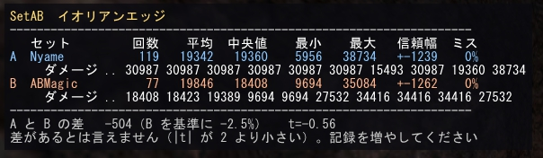
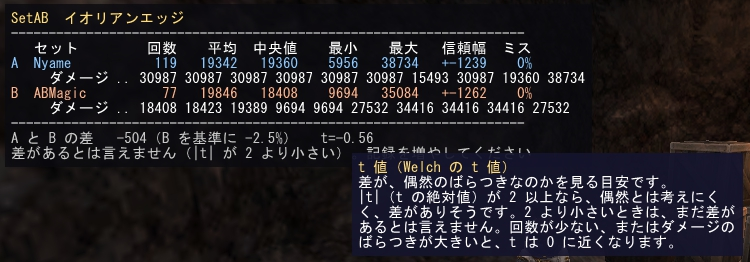
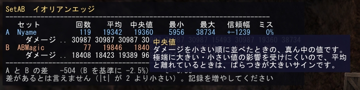

# SetAB 0.3.2 (Windower 4 / Lua 5.1)

[English](https://github.com/hikaruoshino/SetAB-EN)

GearSwap のセットごとに、WS・魔法・ペット技のダメージを自動で記録して、セットどうしを比べるアドオンです。
**読み取り専用**で、パケットは送りません。記録するのは、自分と自分のペットの行動だけです。

「この装備のほうが強いのか」を、数字で確かめるための道具です。

## 導入

1. `addons/setab/` に、`setab.lua` と `setab_stats.lua` を置く
2. ゲーム内で `//lua l setab`

## 使い方

1. 比べたい装備に着替えて、`//setab label Karin` のように名前を付ける（別のセットでも同じ）
2. 普通に戦う（`data/<キャラ名>/log.csv` に自動で保存されます）
3. `//setab report Hot Shot`（技名は、英語名でも、日本語クライアントなら日本語名でも入れられます。名前の一部だけでも構いません。Tab キーの変換（オートトランスレート）も使えます。何を入れればよいか分からないときは、`//setab actions` で一覧を出してください。省略すると、全部の技をまとめます）
4. `//setab compare Karin Fotia Hot Shot`（セット名の空白は、`_` に置き換えて保存します。`Karin Obi` と付けたら、`Karin_Obi` と打ちます）。チャットに結果が出て、画面には、見やすい表（HUD）が開きます

WS は、**撃つ瞬間にだけ**専用の装備に着替えるので、撃つ前に `label` を付けられません。いちど撃ってから、`//setab sets` で hash を見て、`//setab name <hash> <名前>` で名前を付けてください。

| コマンド | 内容 |
|---|---|
| `//setab on` / `off` / `status` | 記録の切り替え・状態 |
| `//setab label <名前>` | 今の装備に名前を付ける |
| `//setab name <hash> <名前>` | hash を指定して名前を付ける（`sets` で一覧） |
| `//setab sets` | 記録されたセットの一覧 |
| `//setab actions [セット名]` | 記録された技名の一覧（回数つき。日本語クライアントでは「日本語名 (英語名)」の形）。`report` と `compare` の `[技名]` に入れる名前を、ここで確かめます。セット名を付けると、そのセットだけの回数 |
| `//setab lang ja\|en\|auto` | 技名を出す言語（`auto` はクライアントの言語）。記録（`log.csv`）の技名は、いつも英語です |
| `//setab report [技名]` | セット別の n・平均・中央値・95%CI・ミス / レジスト率。`[技名]` は、`//setab actions` に出る名前（英語名でも日本語名でも。例: `Aeolian Edge`、`イオリアンエッジ`）。省略すると全部 |
| `//setab compare A B [技名]` | 2 つのセットの差と Welch の t 値。チャットに出して、画面に表（HUD）も開く。例: `//setab compare Nyame ABMagic Aeolian Edge`（`<` と `>` は入力しません）。`[技名]` を省略すると、違う技が混ざるので、注意が出ます |
| `//setab hud` | 表（HUD）を隠す / また出す |
| `//setab hud on` / `off` | `compare` のときに、表を開くか（`off` は、チャットだけにして、表を隠す） |
| `//setab hud size <6〜40>` | 表の文字の大きさ。マウスのホイールでも変えられます |
| `//setab hud reset` | 表の位置と大きさを、初めの状態に戻す |
| `//setab hud tip on` / `off` | 表の上にマウスを置いたときの説明（ツールチップ）を、出す / 出さない |
| `//setab tp <min> [max]` | TP の範囲で絞り込み（WS だけ TP を記録） |
| `//setab target <文字>` | 敵の名前で絞り込み |
| `//setab filter clear` | 絞り込みを解除 |
| `//setab ignore <slot>` | その部位を、セットの判定から外す（例: ammo）。もういちど打つと戻る |
| `//setab reset confirm` | 記録を消す |
| `//setab debug on\|off` | 確認用: 自分と自分のペットの行動の生の値（カテゴリ・param・メッセージ）と TP の変化を、チャットと `data/<キャラ名>/debug.log` に出す |

## 表（HUD）で見る

`//setab compare A B [技名]` を打つと、画面に表が開きます。**上の行が A、下の行が B** で、それぞれの横に、回数・平均・中央値・最小・最大・95% 信頼区間の半分の幅・ミス（レジスト）の割合が並びます。その下の行に、撃った順のダメージ（直近 10 回）が出ます。いちばん下に、A と B の差（B を基準にした割合）、t 値、「差があるか」の判定が出ます。



```
SetAB  イオリアンエッジ   [敵=Locus Blazer Elytra TP=3000-3000]
--------------------------------------------------------------------
   セット         回数    平均  中央値    最小    最大   信頼幅  ミス
A  Nyame             3   36152   38734   30987   38734  +-11112    0%
     ダメージ 38734 30987 38734
B  ABMagic           3   32344   34416   27532   35084  +-10386    0%
     ダメージ 35084 34416 27532
--------------------------------------------------------------------
A と B の差   +3808（B を基準に +11.8%）   t=1.08
差があるとは言えません（|t| が 2.78 より小さい）。記録を増やしてください
```

- **マウスで動かせます。** 表をドラッグすると、位置が変わります（位置は保存されます）。
- **見出しや数字の上にマウスを置くと、意味の説明が出ます。** 回数・平均・中央値・最小・最大・信頼幅・ミス、撃った順のダメージ、A と B の差、**t 値**、判定の文に、それぞれ説明があります。説明は、カーソルの横に、別の小さな枠で出ます（ボタンを押しているあいだ・表が隠れているあいだは、出ません）。出したくないときは、`//setab hud tip off` です。

  

  

- **ホイールで拡大・縮小できます。** 表の上でホイールを回します。表の上にカーソルがあるあいだは、ゲームにホイールは伝わりません。
- 戦闘中に新しい記録が入ると、表は自動で更新されます（1 秒に 1 回まで）。`//setab tp`・`target`・`filter clear` で絞り込みを変えても、更新されます。
- 差の判定は、色で分かります（緑：差がありそう、灰色：差があるとは言えない、橙色：データが足りない）。
- 日本語クライアントでは、表の見出しも判定の文も、日本語で出ます（英語クライアントでは英語です。`//setab lang ja` / `en` で切り替えられます）。文字は、等幅で日本語も出せる MS Gothic です。全角の文字は、2 文字分の幅で数えて、そろえます。

## 記録されるもの

`log.csv` の 1 行が、1 回の行動の、1 体の敵への結果です（範囲攻撃は、敵の数だけ行が増えます）。

`ts, zone, target, actor, action, cat, set, hash, tp, weather, day, buffs, result, dmg, msg, hits`

- `result`: `hit`（ダメージ）/ `miss`（ミス）/ `resist`（レジスト）/ `land`（敵への弱体魔法の成功）
- 複数ヒットの WS・ペット技は、全ヒットの合計を 1 行に記録します（`hits` が当たった数）。
- 魔法は、ダメージのメッセージのときだけ記録します（強化・ヘイストなどは記録しません）。ペットの強化の履行も、記録しません。
- `tp` は、WS を撃つ**直前**の TP です。
- `set` / `hash` は、**WS は開始の時点**、**魔法とペット技は結果が届いた時点**の装備です。WS は、直後に元の装備へ戻る着替えが先に着いても、取り違えません。魔法を、開始（precast のセット）ではなく結果の時点で読むのは、ダメージに効く midcast のセットを着ているのが、その時点だからです。GearSwap で結果のすぐあとに着替える設定のとき、魔法の記録が、元に戻ったあとの装備になることがないかは、ゲーム内では確かめていません。
- 装備の判定は、アイテム ID とオーグメントのハッシュです。耳と指輪も入ります。ammo を変えると別のセットになるので、無視したいときは `//setab ignore ammo` です。

## 比べるときのコツ

- ダメージは、ばらつきが大きいです。回数が少ないうちの差は、言い切らないでください（`compare` は、|t| が基準値より小さいと、差なしとして扱います。基準値は、回数が少ないほど大きく、3 回ずつで約 2.8、10 回ずつで約 2.1、多いと約 2.0 です。2 つのセットのばらつきが大きく違うと、もっと大きくなります（3 回ずつで最大 4.3）。信頼幅も、回数が少ないほど広く出ます）。
- **同じ敵・同じ TP で比べてください。** 敵の種類（魔法防御・耐性）が違うと、同じ装備でも、数字が大きく違います。`//setab target`、`//setab tp` で絞れます。TP 3000 の WS は、ダメージがほぼ決まった値の段になるので、比べやすいです。
- **平均と t 値は、ダメージが出た記録だけで計算します。ミスやレジストは、平均に入りません**（`ミス` の割合に、別に出ます）。命中率が違うセットを比べるときは、平均だけでなく、`ミス` の割合も見てください。
- 敵に掛かっているデバフ（ジオマレーズなど）は、記録されません。掛かっていた時間を、自分で覚えておいてください。天候と曜日は、`weather` と `day` の列に入ります。

## 注意・できないこと

- チャットへの出力の文は、英語です。セット名と技名は、日本語クライアントなら日本語で出ます（Shift-JIS に直して出しています）。
- **ゲーム内で確かめたこと**（日本語クライアント・2026 年 10 月）: WS（単発・多段）の記録と TP、黒魔法と MB の記録、強化・フェイスを記録しないこと、獣使い・召喚獣のペット技の名前とダメージ（ペットの強化の履行は記録されないこと）、敵への弱体魔法の成功とレジスト、WS のミス、耳・指輪がセットの判定に入ること、WS 開始時の装備と TP。
- **表（HUD）で確かめたこと**（0.3.0・日本語クライアント・2026 年 10 月）: 表が開くこと（上が A・下が B・横に値）、日本語の見出し、Tab 変換で入力した日本語の技名、日本語名の技の一覧（文字化けなし）、表のドラッグでの移動、ホイールでの拡大・縮小、見出し・t 値・A と B の差・判定の文の上にマウスを置くと説明が出ること（折り返しも）、`//setab hud tip off`・`//setab hud size`・`//setab hud reset`。
- ミスとレジストの判定は、メッセージ番号の表（`MISS_MSG` = 188・282、`RESIST_MSG` = 85・284・653〜656）で行います。確かめたのは、ミス 188、レジスト 85・653 です。ほかの番号は、まだ実際のゲームで確かめていません。表にない番号は、`msg` の列に生の番号が残るので、後から分類し直せます。
- **0.3.2 で確かめたこと**（学者・召喚士・日本語クライアント・2026 年 10 月）: アスピルを記録しないこと（メッセージ 228）、ドレインをダメージとして記録すること（メッセージ 227・画面の数字と一致）、黒魔法・MB・弱体魔法の記録がこれまでどおりなこと、`label` と `name` の空白が `_` になること、`compare` の判定の基準値（5 回と 6 回で 2.41・多いと 1.97）と表の日本語、読み込み直しても表の位置が保たれること、召喚士の WS の TP とセット（召喚獣の技とほぼ同時に着弾しても取り違えない）。アブゾーブ系と、`report` の「... and N more actions」は、ゲーム内では、まだ確かめていません。WS の開始から着弾までのあいだに、ペットの技がちょうど着弾する場面（0.3.1 で直した点）も、ゲーム内では再現できていません（模擬のテストでだけ確かめています）。
- **英語クライアントでは、まだ確かめていません。**
- Windower の使用は、FFXI の利用規約で認められていません。このアドオンが許されること、検知されないことは、保証できません。自己責任でお使いください。作者は、一切の責任を負いません。

## 更新履歴

* **0.3.2**
  * MP・TP・能力値を吸う技（アスピル、アブゾーブ系など）を、ダメージとして記録していた不具合を直しました。HP を吸う技（ドレインなど）だけを、ダメージとして数えます。0.3.1 までに記録された行は、そのまま残ります（平均に入ります）。気になるときは、`//setab reset confirm` で記録を消すか、`log.csv` の `msg` の列が 228・275・329〜335・366・454 などの行を消してください。
  * 回数が少ないときに、信頼幅と「差がありそう」の判定が甘かったので、t 分布で計算するようにしました。回数が少ないほど、信頼幅は広く、判定の基準値は大きくなります（回数が多いと、これまでとほぼ同じです）。
  * `//setab label` と `//setab name` で、名前の空白（全角の空白も）を `_` に置き換えるようにしました（空白があると、`compare` で指定しにくかったため）。`compare` と `actions` で打った名前も、同じように置き換えて探します。前の版で付けた、空白の入った名前は、`//setab name <hash> <名前>` で付け直してください。
  * `//setab report` が、6 種類目以降の技を省いたことを、表示するようにしました。
  * README を、コードに合わせて直しました（装備を読む時点、ミスが平均に入らないこと）。
* **0.3.1**
  * 召喚士・獣使い・からくり士で、WS の開始から着弾までの間にペットの技が着弾すると、WS の装備と TP が、着弾時のものに取り違えられることがあった不具合を直しました。
  * `log.csv` をほかのソフトで開いていて書き込めないとき、毎フレーム開き直していたのを、10 秒おきにしました。
  * ログイン直後にキャラクターの情報を読めなかったとき、初期化をやり直すようにしました（5 秒おきに最大 3 回）。
* **0.3.0**
  * 表（HUD）の見出し・数字・t 値などの上にマウスを置くと、意味の説明が、別の小さな枠に出ます（`//setab hud tip on` / `off`）。
  * 表（HUD）の見出しと判定の文を、日本語クライアントでは日本語で出すようにしました。
  * 日本語クライアントで、日本語の入力と出力が文字化けしないようにしました（入力は Shift-JIS から、チャットへの出力は Shift-JIS へ変換）。技名は、日本語名で表示し、日本語名でも入力できます（Tab の変換、名前の一部だけでも可）。`//setab actions` で、記録された技名の一覧を出します。セット名が違うときは、知っているセット名を案内します。
  * `//setab compare` で、画面に表（HUD）を開くようにしました（上が A・下が B・横に値と、差の割合）。マウスで動かせて、ホイールで拡大・縮小できます。`//setab hud` で出し入れします。
* **0.2.4**（初めての公開）
  * 行動の開始（WS の開始パケット）の時点で、装備と TP を読むようにしました。結果のパケットで読むと、行動が終わった瞬間に元の装備へ戻る着替えが先に着いて、WS の装備ではなく、直後の装備のセットとして記録されることがありました。TP も、消費したあとの値（100 前後）ではなく、直前の TP が入ります。
  * 敵への弱体魔法の成功（`land`）を記録します。`report` の `miss/resist` は、弱体魔法ではレジスト率（レジスト ÷（成功 + レジスト））になります。
  * 耳・指輪を、セットの判定に入れました。ダメージは、メッセージが「ダメージ」型のときだけ数えます。
  * 召喚獣・獣使いのペット技の名前を、正しく引くようにしました。

## フィードバック

動いた・動かなかった、の一言だけでも、うれしいです。[Issues](../../issues/new/choose) から投稿できます。

## ライセンス

MIT License。`LICENSE` を見てください。
